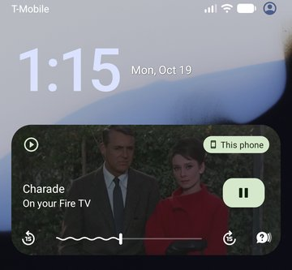
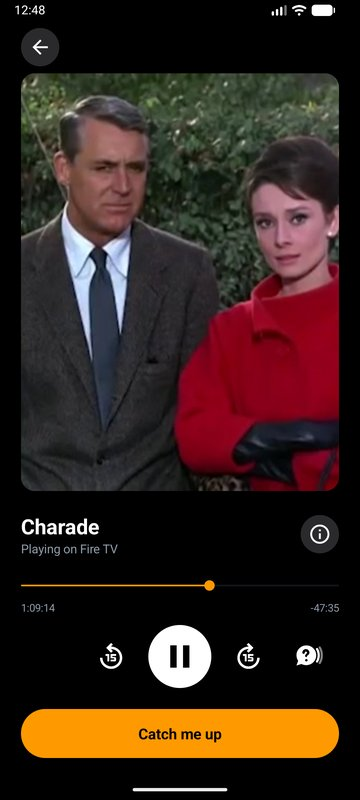
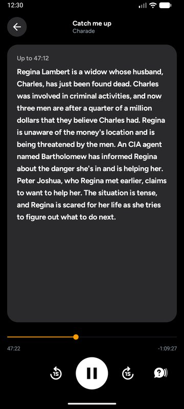
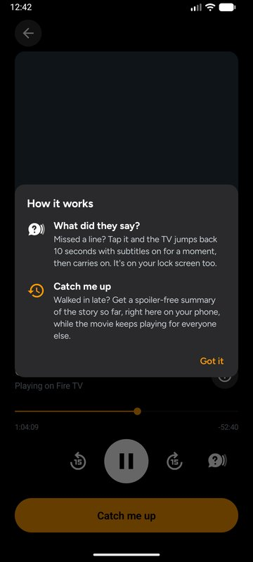

# Couchside

**New features for the Fire TV mobile app: your phone becomes the perfect sidekick for movie night.**

Today the Fire TV mobile app is mostly a backup remote and a way to browse. Couchside turns it into a real second screen for whatever is playing on your Fire TV:

- **Lock-screen controls.** What's playing on the TV shows up on your phone's lock screen and notification shade, just like music: artwork, title, a live scrubber, skip ±15 seconds and play/pause. No app to open, no remote to find.
- **What did they say?** Missed a line? One tap jumps the TV back 10 seconds with subtitles on, just for that line, then carries on.
- **Catch me up.** Walked in late? Get a spoiler-free summary of the story so far on your phone, written by AI (Amazon Bedrock), while the movie keeps playing for everyone else. The further into the film you are, the fuller the recap.

Built for the Amazon Developer Hackathon: **Fire TV track** (multi-modal UX, AI-enhanced viewing) and the **AWS Builder** mini challenge.

| Lock screen | Now Playing | *Catch me up* | How it works |
|---|---|---|---|
|  |  |  |  |

## How it works

```
   Fire TV mobile app  ◄──── home Wi-Fi ────►  Fire TV  ───── HTTPS ─────►  AWS Lambda  ──►  Amazon Bedrock (Nova)
 lock screen, controls,                     what's playing,                 secured with
 What did they say?, recap                  where, what's been said         a secret token
```

1. The Fire TV tells the phone what's playing and where it is, twice a second, so the lock-screen scrubber stays live.
2. Taps on the phone (play, ±15, *What did they say?*) go straight back to the TV.
3. For **Catch me up**, the TV sends only the dialogue spoken so far to a small AWS Lambda function, which asks **Amazon Nova** on Bedrock for a recap sized to how far in you are. It can't spoil what's next, because it never sees it.

## The Fire TV side: our test bench

The phone features need two things from the TV: **what's playing right now**, and **its subtitles**. On a real Fire TV that information would come from Fire OS and the streaming apps. Third-party apps don't share their subtitles with other apps, so to build and demo the full experience end to end, we made a small **Fire OS app that plays the role of a streaming app**:

- a movie list, a details page with *Resume* / *Start over*, and a full-screen player, styled like Fire TV;
- three public-domain films streamed from archive.org (*Charade* has English subtitles, so it's the one that supports every feature);
- a tiny local service the phone talks to over Wi-Fi.

**Why this setup fits:**
- **It's a genuine Fire OS app.** Fire OS is built on Android, so the TV app is a native Android (Kotlin) app built for Fire OS 7 and 8, using only standard Android features and no Google services.
- **The emulator matches Fire OS.** Amazon has no Fire OS simulator (its Vega Virtual Device runs Vega OS apps only), so we used the Android TV emulator on Android 11, the base of Fire OS 8. That's the same Fire OS workflow as Amazon's own [react-native-multi-tv-app-sample](https://github.com/AmazonAppDev/react-native-multi-tv-app-sample), whose "Android TV and Fire TV FOS" target is built and run with the Android SDK.
- **It shows the end state.** In a shipped version, Fire OS would share the now-playing info and subtitles with the Fire TV mobile app directly, and the phone features would work the same way for every app.

## Requirements

**To build and run**
- **Android Studio** (it includes the JDK, the Android SDK, `adb` and the emulators). Add `adb` to your PATH, or run it from the SDK's `platform-tools` folder.
- **Two devices**, either:
  - **Emulators** (from Android Studio's Device Manager): an **Android TV** emulator, API 30, standing in for Fire OS 8, and a **phone** emulator, Android 9 (API 28) or newer; or
  - **Real devices**: a **Fire TV** running Fire OS with *ADB debugging* turned on, and an **Android phone**, both on the same Wi-Fi.
- An **internet connection**: the movies stream from archive.org.

**For *Catch me up* (optional; everything else works without it)**
- An **AWS account** with **Amazon Bedrock** available in **us-east-2**, and access to the **Amazon Nova** models (Nova 2 Lite / Nova Micro).
- **AWS CLI v2**, signed in (`aws login`).
- **Windows PowerShell** to run `recap\deploy.ps1`.
- Optional: **Python 3.13** to run the recap service's tests.

## Try it

```powershell
# 1. Recap service (optional; everything except Catch me up works without it)
aws login
powershell -File recap\deploy.ps1          # deploys to AWS and saves the URL + secret token to .env

# 2. Build the phone app and the Fire TV test bench
.\gradlew.bat :phone:assembleDebug :tv:assembleDebug
# For a real Fire TV, build the phone app with:  -PtvHost=<fire-tv-ip>

# 3. Install and connect (emulators)
adb -s emulator-5556 install -r phone\build\outputs\apk\debug\phone-debug.apk
adb -s emulator-5554 install -r tv\build\outputs\apk\debug\tv-debug.apk
adb -s emulator-5554 forward tcp:8765 tcp:8765
```

Then open **Fire TV** on the TV, pick *Charade* and press play. On the phone, open the app, or just lock the phone and use the media card.

More detail on the recap service is in [recap/README.md](recap/README.md).

## Built with

Kotlin · Android Media3 · AWS Lambda · Amazon Bedrock (Amazon Nova) · Figtree font

## Known limitations

- Today *What did they say?* and *Catch me up* work with movies played in the test-bench TV app. Inside other apps (Netflix, Prime Video…) the rewind part already works through the app's media session, but two pieces need Fire OS support, which is the integration we're proposing: a way to switch on another app's subtitles for a moment (*What did they say?*), and access to the playing title's subtitle text on the TV (*Catch me up*, whose recap the TV relays to the phone).
- Recaps are based on the subtitles only, so they can occasionally mix up who said what.
- Tested on emulators; not yet run on a physical Fire TV.
